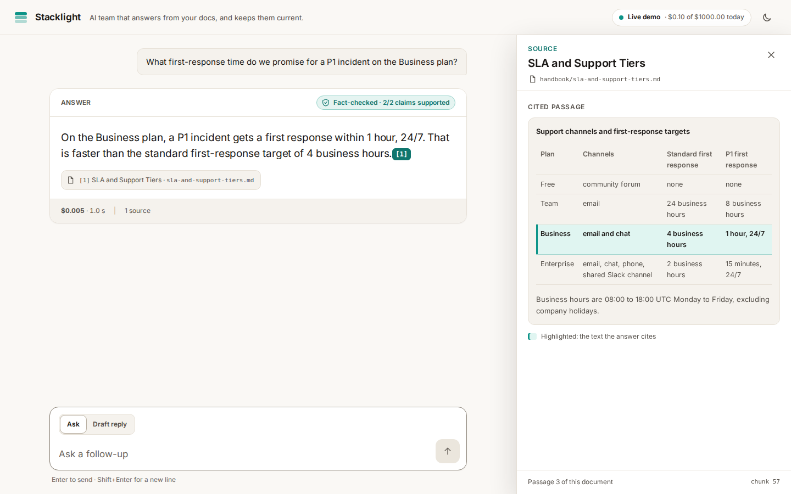
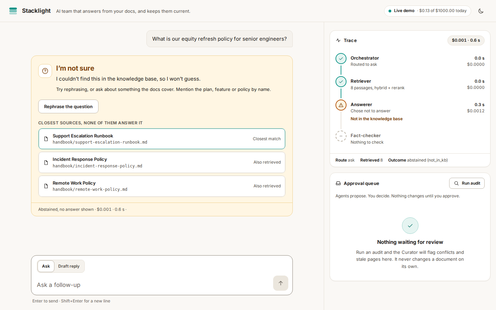
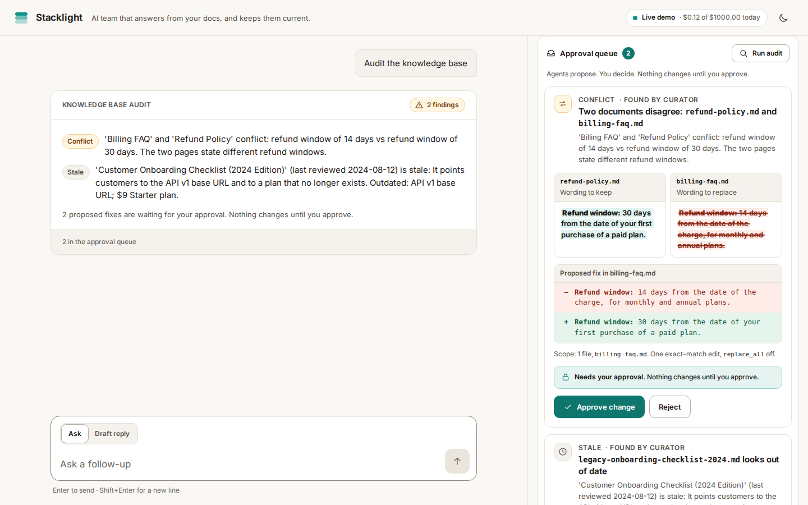
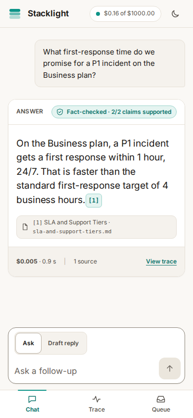
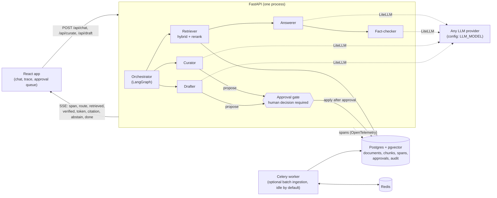

# Stacklight

**An AI team that answers from your documents, cites every answer, keeps the documents current, and tells you when it is not sure.**

Ask a question and a small team of agents retrieves the evidence, writes an answer using only those passages, and
checks every claim against its source before you see a word. If the documents do not contain the answer, it says so
and shows the closest sources instead of guessing. A Curator agent audits the knowledge base for conflicting and stale
pages and proposes exact fixes; a Drafter writes support and sales replies. Nothing is sent and nothing in the knowledge
base changes without a recorded human approval.

**Live demo: [stacklight.hamzacodes.dev](https://stacklight.hamzacodes.dev)** (no login; click **How it works** for a 30-second tour). It runs on a made-up company's docs, "sending" is simulated, the sample knowledge base resets every 6 hours, and a daily spend cap pauses it if it is overused.



*A verified, cited answer; the citation opens the exact passage it came from. Screenshots in this README come from the
browser end-to-end run with a deterministic stubbed model (`make e2e-screens`), so the cost and latency figures in them
are stub values, not measurements of a real model.*

| When the answer is not in the documents | Agents propose, a human approves |
|---|---|
|  |  |
| It abstains, says why, and lists the closest sources (none of which answer the question). | The Curator found two pages that disagree on the refund window and proposes one exact edit. Nothing changes until you approve. |

 The same screen at phone width (Chat / Trace / Queue tabs).

## What it does

Seven agents share one knowledge base (a synthetic company handbook plus support tickets and an open-source project's docs, all in `corpus/`).

| Agent | Role |
|---|---|
| Orchestrator | Routes each request (answer, audit, draft), owns run state, retries a failed step once. |
| Ingestion | Parses, chunks, embeds and stores documents; unchanged files are skipped. The first corpus seed runs in the API process; the Celery worker is an optional batch-ingestion worker and is idle by default. |
| Retriever | Hybrid search (vector + keyword, merged with reciprocal rank fusion), then a cross-encoder rerank. |
| Answerer | Writes an answer from the retrieved passages only, with quotes; an answer without a valid citation is discarded. |
| Fact-checker | Checks each claim against its cited passage, scores faithfulness, and triggers abstention below 0.7. |
| Curator | Finds conflicting and stale documents and proposes an exact edit for each. |
| Drafter | Drafts a support or sales reply to a ticket from knowledge-base content, with citations; secrets in the ticket are redacted. |

**The invariant: every outbound reply and every knowledge-base change needs a human approval.** This is structural, not a
prompt instruction. Agent code cannot write to the knowledge base or "send" anything: the only thing an agent can
do is `propose()` a record into the approval service, which alone applies a change, and only after a human decision
is stored. A test parses the source of every module in `backend/app/agents/` with Python's `ast` module and fails on any
import, call or SQL-shaped string that could bypass the gate (database drivers, ingestion, the approval internals, `eval`/`exec`,
and so on). A second test fails if any module outside the ingestion pipeline, the approvals service and the scheduled demo reset writes to the documents tables.

## Architecture



Four containers: `app` (API + the built React UI), `worker`, `postgres`, `redis`. Measured about 1.0 GB of RAM in total
after seeding and one warm query.

## Evidence

Retrieval quality of naive vector search versus the hybrid pipeline (vector + keyword + RRF + cross-encoder rerank), top-8,
measured by `evals/run.py` on the shipped corpus. These are the committed results in `evals/results/*.retrieval.json`;
no language model is involved in this table.

| Metric | Naive vector RAG | Hybrid + rerank |
|---|---|---|
| Hit rate@1 | 26.7% | 51.1% |
| Hit rate@3 | 68.9% | 86.7% |
| Hit rate@5 | 80.0% | 93.3% |
| Hit rate@8 | 86.7% | 93.3% |
| MRR | 0.496 | 0.681 |

53 questions (45 answerable), no model involved, dataset sha256 `d276614d8daf`, results recorded at code commit `136249cdb6bd` (the table is the output of `python evals/report.py`).

**Answer-level table**, from `make eval` with a live model (`claude-haiku-5-5`), on the same 53 questions. Both pipelines use
the same Answerer and Fact-checker; only retrieval differs.

| Metric | Naive vector RAG | Hybrid + rerank |
|---|---|---|
| Citation rate | 100.0% | 100.0% |
| Faithfulness (mean) | 0.969 | 0.965 |
| Abstention accuracy | 92.5% | 90.6% |
| Correct abstention (unanswerable) | 100.0% | 100.0% |
| Answer rate (answerable) | 91.1% | 88.9% |
| Mean cost / query | $0.0004 | $0.0005 |
| Mean latency / query | 3770 ms | 6762 ms |

Run at code commit `5e31d1bfcbf6`, dataset sha256 `d276614d8daf`. Read it honestly: hybrid + rerank retrieves better
(table above) but does **not** improve answer-level faithfulness or answer rate here, and it costs about 1.8x the latency
(the cross-encoder runs on CPU). Faithfulness is already near ceiling for both, and the differences between the two columns
are within what a 53-question set can resolve, so no claim is made that either pipeline answers better.

**Caveats, stated plainly.**
- The 53 questions (45 answerable, 8 unanswerable) were **drafted by Claude and have not yet been hand-checked by the
  author** (`evals/dataset.meta.json` has `"reviewed": false`). Treat the numbers as provisional until that review is done.
  The report prints a provisional note for as long as the flag is false.
- The corpus is small (81 documents) and synthetic, written for this demo. Retrieval on your own documents will differ.
- Hit rate and MRR say whether the right passage was retrieved; they do not say the final answer was right.

**What the metrics mean.** *Hit rate@k*: the share of answerable questions for which a gold passage is in the top k
retrieved chunks (a hit needs the right file and the exact gold snippet inside the chunk). *MRR*: mean of 1 / rank of the
first gold passage (0 when it is missing); higher is better, 1 is always first. Measured by `make eval`: *citation rate*
(answers with at least one valid citation), *faithfulness* (share of claims the Fact-checker finds supported), *abstention
accuracy* (answers when answerable, abstains when not), and mean cost and latency per query.

**Reproduce.**

```bash
make seed && make eval-retrieval     # the table above (needs the dev database; downloads two small models once)
make eval                            # adds the answer-level table; needs a provider key (e.g. ANTHROPIC_API_KEY) and LLM_MODEL in the environment
python evals/report.py               # re-render the table and the one-line summary from the committed JSON
```

Pinned for these results: embeddings `BAAI/bge-small-en-v1.5` (384 dimensions), reranker
`cross-encoder/ms-marco-MiniLM-L-6-v2`, dataset hash and git commit recorded in each results file. Answer-level runs also
record the LLM model, provider and temperature.

## Run it

```bash
cp .env.example .env
# edit .env: set a provider key and the matching LLM_MODEL (for example ANTHROPIC_API_KEY and claude-haiku-5-5)
docker compose up -d --build
```

Open <http://127.0.0.1:8780>. The first start downloads the two small models and seeds the synthetic "Quillbase" corpus
in the background (81 documents, about 1.5 minutes on the build machine; the status pill reads "Preparing the knowledge base..."
until it is ready). Later starts are immediate.

- **No key?** The app still loads and retrieval works, but a run fails cleanly with an "answer service isn't responding"
  banner and nothing is changed.
- **Swap the model** by changing `LLM_MODEL` to any [LiteLLM](https://docs.litellm.ai) model string and setting that
  provider's key. Cost per run is shown in the UI when LiteLLM has a price for the model, and "cost unknown" otherwise
  (unpriced models are charged a flat estimate against the spend cap so they cannot bypass it). Embeddings and the reranker run locally and are configurable too.
- **Loopback only by default** (`127.0.0.1:8780`). **There is no authentication.** Do not bind it to `0.0.0.0` or
  publish it without the safeguards below; anyone who can reach it can spend your LLM budget.
- **Running it for yourself, not as a public demo?** Whoever can reach the UI can approve KB edits: put your own auth in front (for example Cloudflare Access).
  Set `DEMO_RESET_INTERVAL_H=0` before loading your own documents; the scheduled reset deletes anything outside `corpus/`.

## Safety for a public demo

Because anyone can click Approve on an open instance:

- **Send is simulated.** An approved reply is logged to the audit trail; nothing leaves the system.
- **The knowledge base resets on a schedule** (every 6 hours by default): the shipped corpus is restored and approvals, audit rows and run records are cleared.
- **Per-IP rate limits** (`RATE_LIMIT_PER_MIN`) on chat, audit, draft and approval decisions, and a cap on concurrent streams per IP; the number of queued runs is also bounded.
- **Daily spend cap** (`DAILY_SPEND_CAP_USD`): when reached, the demo switches to a "demo paused" notice until the next UTC midnight.
- **Cost is shown per run** and today's spend against the cap is in the header.
- Approval records are still stored, to show the gate working.
- **Drafts are public.** `GET /api/approvals` shows every visitor's (redacted) draft ticket text to everyone until the next reset; the draft box says so.
- Approval decisions are refused (HTTP 503 "resetting") while a scheduled reset is running.

Public deployment through a Cloudflare Tunnel is written up in [docs/deploy.md](docs/deploy.md); it has not been executed.

## Design decisions and trade-offs

- **Hybrid retrieval, reranked.** Vector search catches paraphrases, keyword search catches exact terms (plan names, error codes), reciprocal rank fusion merges them without tuning score scales, and a small CPU cross-encoder reorders the shortlist. Adds some CPU time per query, needs no paid API, and is fully reproducible.
- **Abstention is built in.** The Answerer never calls the model with nothing retrieved, discards answers without a valid citation, and the Fact-checker abstains below 0.7 faithfulness. A retrieval-score floor exists as a setting but is **disabled**: it has not been calibrated against real-model runs.
- **Verified before streaming.** The model's answer is checked first and the verified text is then replayed to the browser word by word. The UI never shows unverified text; the cost is that nothing appears until the check finishes (the UI shows "Verifying sources..." with the trace advancing).
- **Tracing in Postgres.** Every agent step is an OpenTelemetry-style span stored in the app's own Postgres and shown in the in-app trace panel with per-step cost and latency. A self-hosted Langfuse would need ClickHouse, MinIO and more containers, and its UI would sit outside the demo screen.
- **Model text is rendered as plain text.** Answers, finding summaries, drafts and diff lines are shown through text nodes only; bold and citation chips are produced by the app from structured data.
- **Runs and SSE live in the API process.** Simple and enough for a demo; the consequence is a single API worker (no horizontal scaling, and a restart drops in-flight runs). Moving run state to Redis is the obvious next step.
- **One SPA, no separate frontend server.** React + TypeScript built with Vite and served by FastAPI; fonts are self-hosted.

## Honest limitations

- The eval dataset is unreviewed (drafted by Claude) and small (53 questions, 8 unanswerable), so the answer-level numbers are provisional and the two pipelines are not statistically separable on them.
- The Curator, Drafter and answer path were exercised against deterministic stub models in tests and in the browser. Only the answer path (Answerer and Fact-checker) has been measured against a live model (the table above); the Curator and Drafter have **not**. Expect to tune prompts and the 0.7 threshold once you measure.
- Single API worker; no authentication or multi-tenancy by design; the "send" is simulated.
- The corpus is synthetic (plus unmodified Commander.js docs, MIT, see `corpus/LICENSES.md`); keyword search is English only.
- Python and Node dependencies are lower-bounded (no lock or constraints file for the backend) and the Docker base images are not pinned by digest, so a fresh build can pick up newer versions.
- The Curator's stale cutoff is computed from today's date; the corpus pages are dated 2026-02 to 2026-06, so the single stale finding will change as time passes.
- The Curator only reports conflicts it finds among the top candidate pairs per audit (capped), and a rejected finding can be proposed again on the next audit.

## What was verified, and how

- Backend unit and integration tests against a real Postgres + pgvector: 350 pass (13 slow model tests and the browser tests are deselected by default).
- Frontend: TypeScript typecheck and component tests (Vitest): 79 tests in 11 files pass, typecheck clean.
- Browser end-to-end (Playwright, real app and real database, deterministic stubbed model): 7 pass (4 screenshot-capture tests only run with `make e2e-screens`), including the 30-second demo script and light/dark, desktop/phone screenshots.
- Cold start from a clean clone with `docker compose up`: four containers healthy, 81 documents seeded automatically in about 1.5 minutes, about 1 GB RAM, no re-seed or model re-download on restart.
- CI is defined in `.github/workflows/ci.yml` but **has not run yet**.
- Not verified: behaviour with a live model (answer quality, cost, latency), and the public deployment.

## Repo map

```
backend/app/agents/      the agents (Orchestrator, Retriever glue, Answerer, Fact-checker, Curator, Drafter)
backend/app/approvals/   the approval gate: propose, decide, apply, simulated send, audit
backend/app/retrieval/   vector, keyword, RRF fusion, rerank
backend/app/ingestion/   parse, chunk, embed, store
backend/app/safety/      rate limits, spend cap, scheduled demo reset
backend/app/tracing/     spans, cost accounting, SSE pubsub
backend/app/api/         FastAPI routes, run manager, static serving
backend/tests/           tests (e2e/ holds the browser tests and the stub-model server)
frontend/                React + TypeScript SPA (Vite)
corpus/                  synthetic handbook, tickets, open-source docs; generator and licences
evals/                   dataset, metrics, runner, report, committed results
docs/                    design mockups and tokens, UI screenshots, demo script, deployment notes
```

## Development

```bash
make test           # backend tests (starts the dev Postgres + Redis on 127.0.0.1:15432 / 16379)
make web-test       # frontend tests (Node runs in Docker only)
make web-typecheck  # TypeScript check
make e2e            # builds the UI, runs the browser tests against the real app with a stubbed model
make e2e-screens    # same, and rewrites docs/ui/screens/*.png
make seed           # load the corpus into the dev database
make eval-retrieval # retrieval-only eval (no key)    |  make eval   # full eval (key + LLM_MODEL)
```

Backend: Python 3.12+ in `backend/.venv` (`pip install -e "backend[dev,e2e]"`; CPU torch from the PyTorch extra index).

Demo recording plan: [docs/demo-script.md](docs/demo-script.md). UI design notes and known
deviations from the mockups: [docs/design/README.md](docs/design/README.md).

License: MIT (see `LICENSE`). Third-party corpus documents keep their own licenses, see `corpus/LICENSES.md`.
